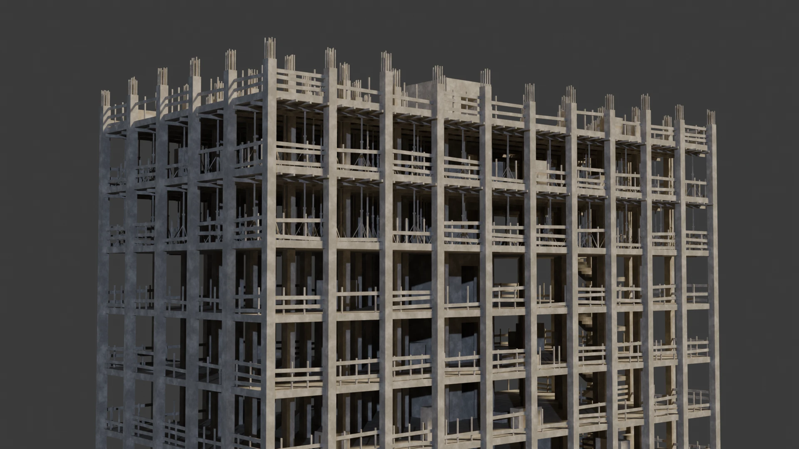
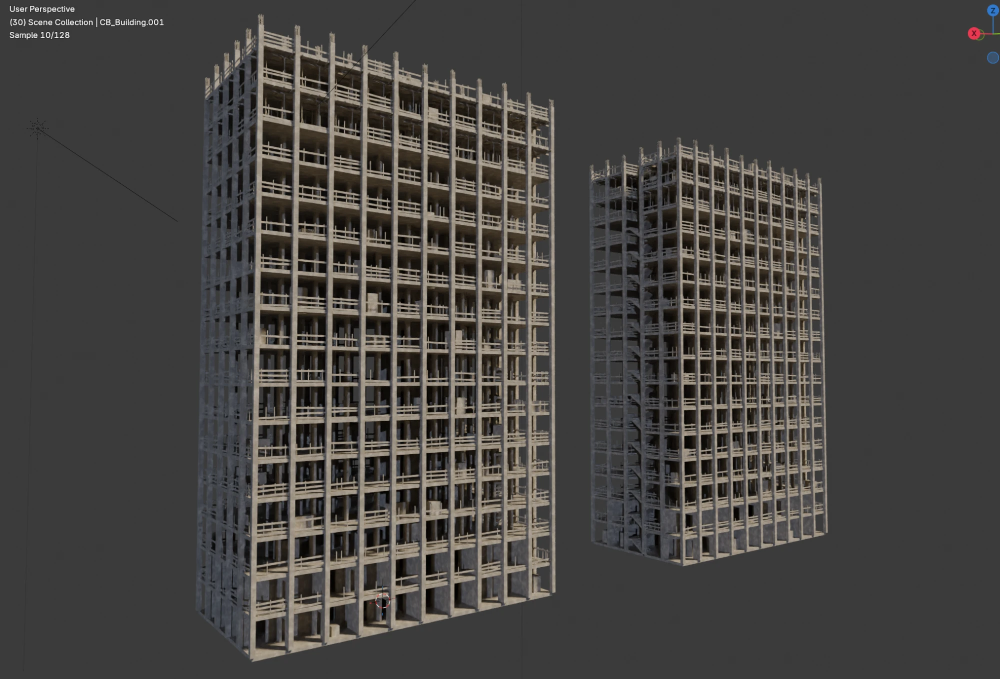
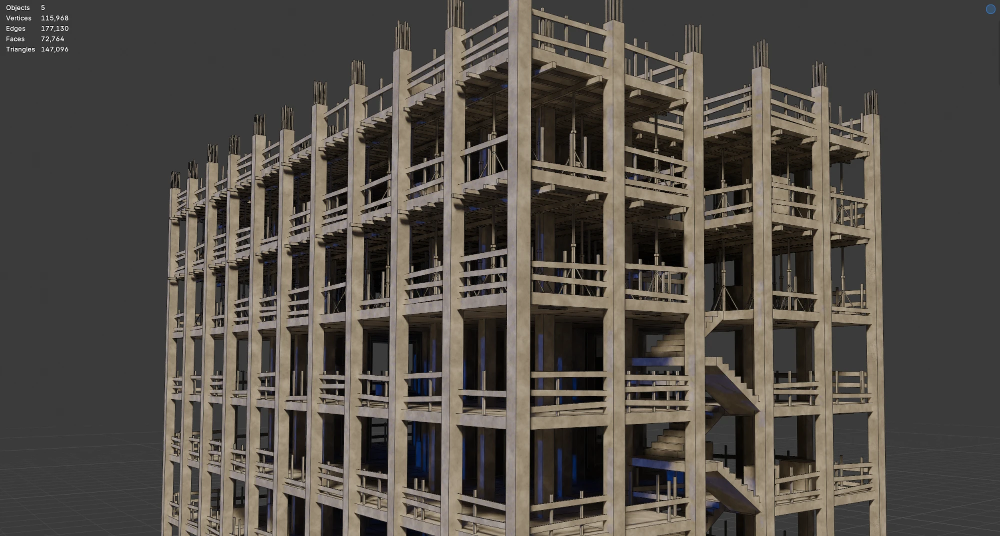
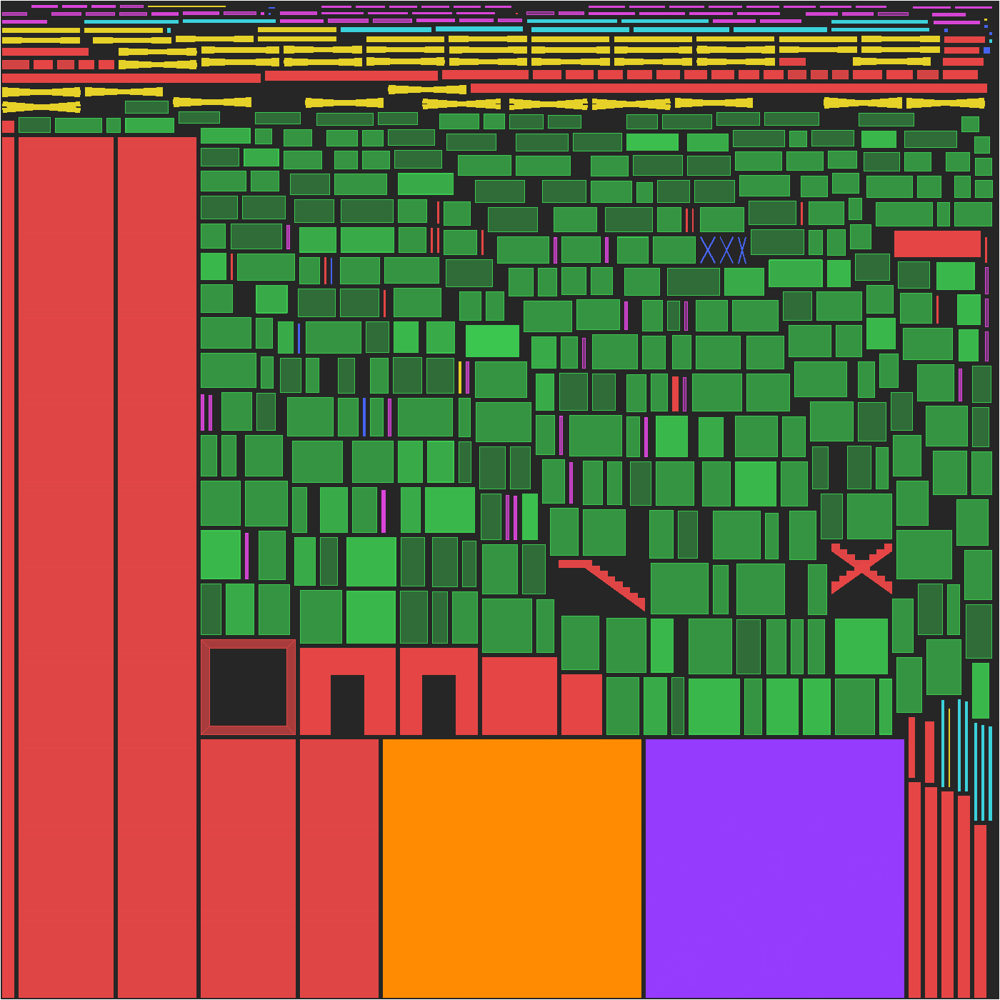

# ConstructionBuilder

**English** | [Русский](README.ru.md)



A Blender 5.2+ extension that builds the frame of a building under construction: floor slabs, columns with rebar, interior walls, elevator shafts, fire stairs, formwork props, railings, construction lamps and debris, like a cast-in-place reinforced-concrete house at the "bare frame" stage. The result is ready for a game engine: every object has UVs (box projection, packed into one 0-1 tile), and FBX export is one button.



The building can be a rectangle, an L shape, a U shape, or have a podium (a tall first storey). One side can also be left unfinished: lower than the rest, as on a real site.

## Installation

1. Build the zip (once, from any folder):

   ```bash
   "C:\Program Files\Blender Foundation\Blender 5.2\blender.exe" -b --command extension build --source-dir D:\Blender\ConstructionBuilder --output-dir D:\Blender\ConstructionBuilder\dist
   ```

   The `dist` folder must exist, create it first.

2. In Blender: **Edit → Preferences → Get Extensions → arrow in the top right corner → Install from Disk** and pick `construction_builder-0.19.0.zip`.
3. Enable the **ConstructionBuilder** extension.

For development you do not need the zip: in **Preferences → Get Extensions → Repositories → Add Local Repository** point to the folder that holds `ConstructionBuilder`, or simply copy the extension folder to `%APPDATA%\Blender Foundation\Blender\5.2\extensions\user_default\`.

## Versions

The version lives in one place: the `version` field of `blender_manifest.toml`. It is shown at the top of the panel and is part of the zip name (`construction_builder-0.19.0.zip`). Every code change bumps the version and adds an entry to [CHANGELOG.md](CHANGELOG.md). To update an installed extension, remove the old one and install the new zip.

## Where the panel is

3D Viewport → **N** sidebar → **ConstructionBuilder** tab.

## Language

The panel is in English. Switch Blender to Russian (**Edit → Preferences → Interface → Language → Русский**, with Interface and Tooltips ticked) and the panel, the tooltips, the buttons and the messages are in Russian. The documentation is in English ([README.md](README.md), this file) and in Russian ([README.ru.md](README.ru.md)); the code comments are in both languages.

## How to work

1. Set the building parameters (table below).
2. Press **Rebuild**. The building appears in the `ConstructionBuilder` collection.
3. Changed a parameter? Press **Rebuild** again: the old result is replaced by the new one.
4. **Export FBX** saves everything to one file (and the ID mask PNG next to it), **Open Folder** opens the folder with it.

Parameters do not apply by themselves: until you press Rebuild, the scene keeps the previous version.

## Parameters

Paired fields (for example Width/Depth) share one row in the panel.

| Parameter | What it does | Default |
|---|---|---|
| Modules X / Y | Number of floor modules along X (the building width) and Y (the length) | 4 / 3 |
| Floors | Number of floors (slabs) | 5 |
| Shape | Footprint seen from above: Rectangle, L-shape or U-shape | Rectangle |
| Cut Width / Depth | Size of the cut-out block in modules (L and U only) | 2 / 2 |
| Floor Height | Distance between neighbouring slabs, m | 3 |
| Module Size | Side of a square module and the column grid step, m | 3 |
| Podium | Podium (stylobate): the first storey is several times taller, with the shaft and stairs but no partitions. Walls, debris and railings start from floor 2 | off |
| Podium Height | How many normal storeys tall the first storey is (podium only) | 2 |
| Unfinished Part | One side of the building is lower, not built yet (see Unfinished part below) | off |
| Side | Which side is lower: +X, -X, +Y or -Y (unfinished part only) | +X |
| Width | How many module rows on that side are lower (unfinished part only) | 3 |
| Missing Floors | How many storeys that part lacks (unfinished part only) | 2 |
| Edge Bias | Random details (lamps, holes, debris) gather near the outer edge of the building. The chance in the deepest module is this much lower than at the edge: 0 = even, 1 = none in the middle | 0.7 |
| Center on Origin | Centre the building on the origin (otherwise its corner sits at the origin) | off |
| Slab Thickness | Slab thickness, m | 0.3 |
| Ground Slab | A slab at ground level so the building stands on the ground. Top at Z = 0, it has its edge thickness, no bottom face (it is in the ground) | on |
| Column Size (Width/Depth) | Column size along X / along Y, m | 0.4 / 0.4 |
| Column Top Extension | How far the columns stick out above the top slab, m (like rebar stubs on a real site) | 1 |
| Height Variation | Each column rises above the top slab by a further random height from 0 to this value, m, so the tops differ | 0.5 |
| Seed | Random seed: with the same value Rebuild gives the same column heights, rebar, walls, doors, railings, debris, lamps and holes | 1 |
| Rebar | Add rebar: 9 rods on top of every column | on |
| Rebar Height | How far the rods stick out above the column, m | 0.8 |
| Height Random | Every rod has its own height: Rebar Height ± this value, m (random, depends on Seed) | 0.1 |
| Rebar Size | Side of the square rod section, m | 0.04 |
| Walls | Build interior walls (the outer contour stays an open frame) | on |
| Wall Floors | Floors with walls: `1-3, 5` or `all`. Floor 1 is between the ground and the first slab | 1-2 |
| Wall Thickness | Wall thickness on the grid line, m | 0.2 |
| Wall Chance | Share of the inner grid edges that get a wall (random, depends on Seed). The same on every floor, so rooms stack. 1 = walls everywhere | 1 |
| Door Chance | Share of walls with a door opening (random, depends on Seed), the rest are solid | 0.4 |
| Door (Width/Height) | Opening width and height, m. Centred in the wall, from the floor | 1.2 / 2.1 |
| Elevator Shafts | Build elevator shafts | on |
| Count | Number of shafts. They stand in a row along X in the middle row of the building, centred | 1 |
| Padding | Clear gap between neighbouring shafts, m (rounded to whole modules): 3, 9, 18 | 9 |
| Custom Modules | Optional. Shaft modules by hand as X,Y pairs from 1 separated by `;`: `2,2; 8,2`. When filled in, Count and Padding are ignored | empty |
| Shaft Wall | Shaft wall thickness, m | 0.3 |
| Top Block | Height of the shaft's top block above the roof, m: its last floor with a door, standing on the top slab. It gets a door when it is at least 1.5 m high. 0 = the shaft ends at the roof | 3 |
| Door Side | Side of the shaft with a door on every floor: -Y, +Y, -X, +X | -Y |
| Corner Columns | What to do with the four corner columns of a shaft, which would otherwise end up inside the walls of its top block: Trimmed (end at the roof slab, no rebar), Removed (the shaft walls carry the floors), Full (like every other column) | Trimmed |
| Clear Walls | No interior walls within this many modules around a shaft, so the shaft stays visible. 0 = only the shaft's own module | 1 |
| Fire Stairs | Fire stairs: a hole in every slab with a stair inside | on |
| Style | Look of the flights: Concrete Flight (one concrete flight: steps on an inclined slab, like a precast flight) or Blocks (one box per step, stepping up) | Concrete Flight |
| Position | Where the stairs stand: Center (one in the middle), Edge (one at the -X end), Both Ends (one at each end along X) | Center |
| Built Up To Floor | The stair is built from the ground up to this floor. Above it only the hole in the floor remains. 0 = holes only | 3 |
| Formwork Props | Formwork props under the top slabs | on |
| Top Slabs (Formwork) | How many of the top slabs are propped | 2 |
| Spacing | Distance between props, m (rounded so that a whole number fits in a module) | 1.5 |
| Overhang | At the outer edge of the building the timber beams stick out past the slab by a random length from a quarter of this value up to it, m. 0 = flush with the slab | 0.4 |
| Tripods | Three legs on the floor around every prop. Turn off for fewer polygons | on |
| Railings | Railings on the open slab edges | on |
| Floors (Railings) | Floors with railings: `3-6` or `all`. Numbered like Wall Floors: 1 is the ground, the highest number is the roof | all |
| Height (Railings) | Railing height above the slab, m | 1.1 |
| Boards (Min/Max) | Number of horizontal boards in every railing span: random between the two | 1 / 3 |
| Posts (Min/Max) | Number of vertical posts in every span: random between the two | 1 / 3 |
| Tilt | Every board is tilted by a random angle between minus and plus this value | 5° |
| Lamps | Construction strip lamps under the slabs | on |
| Floors (Lamps) | Floors whose ceiling gets lamps: `2-5` or `all`. Lamps of floor k hang under slab k | all |
| Factor (Lamps) | Share of the modules with a lamp, before the edge bias | 0.3 |
| Length (Min/Max) (Lamps) | Lamp length, m | 0.8 / 1.6 |
| Slab Holes | Random square holes in the slabs (for pipes), more of them near the edge | on |
| Factor (Holes) | Share of the slab modules with a hole, before the edge bias | 0.08 |
| Size (Min/Max) (Holes) | Side of a square hole, m | 0.5 / 1 |
| Debris | Add debris: boxes (bricks, pallets) on the floors | on |
| Floors (Debris) | Floors with debris: `1-3, 5` or `all`. Numbered like Wall Floors: 1 is the ground, the last number (floors + 1) is the roof | all |
| Factor (Debris) | Share of the modules on the chosen floors with a box (random, depends on Seed). 0 = none, 1 = every module | 0.2 |
| Height / Length / Width (Min/Max) | Box size ranges, m | 0.5-2 / 1-2 / 0.4-1 |
| One Material | On export every object gets the single material `CB_Building` with the ID mask, so the FBX and Substance have one texture set. The group materials come back afterwards | on |
| Single Mesh | Bake the whole building into one mesh `CB_Building` with one material and one UV, which is easier to texture | off |
| UV Margin | Gap between UV islands in the tile (shrinks by itself when there are very many islands) | 0.005 |
| Split Slabs | Cut the UVs of the slabs into pieces (see Cut Size) instead of one huge island per floor. Identical pieces stack on each other, so the slabs take little space and the rest of the building gets a bigger scale. The slab texture then repeats every piece | on |
| Cut Size | Size of a slab piece in modules: 3 = 3 x 3 modules (9 x 9 m with 3 m modules). Smaller pieces save more space but repeat the texture more often | 3 |
| Cut Height | Cut the UVs of tall objects (columns over many floors) every this many metres: a very tall island would limit the scale of the whole tile. A building lower than this (under 10 floors at 3 m) is not cut. 0 = do not cut | 30 |
| Group by Material | Split the UV islands into groups (concrete, floors, ceilings, debris, formwork, railings, beams, lamps): only islands of one group stack, and every group has its own colour in the ID mask | on |
| ID Mask | A colour ID mask (PNG) and a flat group-colour material on every object | on |
| Mask Size | ID mask size, pixels | 2048 |
| Overlap Similar | Put UV islands of a similar size on top of each other to save space | on |
| Similarity | How close in size two islands must be: their width and height may differ by at most this fraction (0.02 = 2%, like Range in TechArt Tools) | 0.02 |

Under the building parameters the panel shows the resulting size: width × length × height in metres and the number of modules. Height = Floors × Floor Height (plus the podium extra).

## What is built



### Objects

Ten meshes in the `ConstructionBuilder` collection, all with their origin at (0, 0, 0):

* **`CB_Floors`**: all slabs of all floors.
* **`CB_Columns`**: all columns with rebar.
* **`CB_Walls`**: interior walls. Created only if walls are on and there is something to build on the chosen floors.
* **`CB_Shafts`**: elevator shafts. Created only if shafts are on and the modules are valid.
* **`CB_Stairs`**: fire stairs. Created only if stairs are on and `Built Up To Floor` is above 0.
* **`CB_Formwork`**: steel formwork props (base plates, tubes, collars, head plates, tripods). Created only if formwork is on.
* **`CB_FormworkBeams`**: timber formwork beams (both layers). A separate object so the timber has its own ID.
* **`CB_Railings`**: railings. Created only if they are on and there are open edges.
* **`CB_Lamps`**: construction lamps under the slabs. Created only if lamps are on and at least one was picked.
* **`CB_Debris`**: construction debris. Created only if debris is on and at least one box was picked.

With `Single Mesh` there is one object, `CB_Building`, instead.

Do not rename them: Rebuild finds and updates the old result by these names. Anything you edit by hand in these meshes is lost on Rebuild.

### Slabs

* A slab is made of square modules (3×3 m by default).
* **Ground slab** (`Ground Slab`, on by default): a slab like the others with its top at Z = 0 and its thickness going down. Its underside is in the ground, so it has **no bottom face**, while the top and the edges along the contour stay (the thickness is visible). It is solid: there is no hole under a shaft or stair, they stand on it. Everything above (walls, stairs, debris on floor 1) keeps the same heights. Columns start at Z = 0.
* The first floor slab stands one storey up. With `Ground Slab` off there is no slab at ground level and the columns start from zero.
* The top of the last slab is at `Floors × Floor Height` (plus the podium extra).
* **Modules are stitched into one mesh.** Every module has a top and a bottom, and side faces only where it has no neighbour:
  * corner module: 2 side faces;
  * edge module: 1 side face;
  * inner module: no side faces.

  Then coinciding vertices are merged. There are no extra polygons or seams inside the slab, only the edge faces the outside.
* Random square holes (see Slab Holes) and the holes for shafts and stairs are cut through the upper slabs.

### Columns

* A column stands at every node of the module grid, that is at every corner of every module.
* A column runs from the ground to the top of the last slab plus `Column Top Extension`.
* Columns simply **cross** the slabs: no boolean operations, the meshes are not merged.
* A column has no bottom face: its foot goes into the ground.
* Above the top slab the columns have different heights: `Column Top Extension` plus a random addition from 0 to `Height Variation` (depends on `Seed`).
* **Rebar.** 9 thin boxes stick out of the top of every column, a 3×3 grid. Every rod has its own height: `Rebar Height` ± `Height Random`. A rod starts a little inside the column and has no bottom face. All rod faces are smooth-shaded (one smoothing group), column faces stay flat. Turn it off with the `Rebar` checkbox. The rods are part of the `CB_Columns` mesh and share its UVs.

### Walls

* **Interior only**: at most one wall on every inner grid edge between two modules. `Wall Chance` decides which edges get a wall. There are no outer walls, the perimeter stays an open frame.
* A wall stands between two columns and between two slabs: from the top of the lower slab (from the ground on the first floor) to the underside of the upper one. It does not enter the columns or the slabs.
* The wall thickness is set on the grid line (the wall is centred on it), the column is wider than the wall.
* Two kinds of wall:
  1. **Solid**: a rectangle.
  2. **With a door**: an opening from the floor, centred in the wall, with a lintel above it.
* The kind is random: the share of walls with a door is `Door Chance`, the result depends on `Seed` and repeats on Rebuild. Every choice is tied to the element itself and `Seed`, so changing the `Wall Floors` list, `Clear Walls` or `Wall Chance` does not reshuffle the other walls and doors.
* The door topology is optimised: every side of a wall is three quads whose borders run from the top corners of the wall to the top corners of the opening. There are no extra vertices on the top edge.
* Only visible surfaces are built: the two sides, and for a door also the jambs and the underside of the lintel. The ends (they touch the columns), the top and the bottom (they touch the slabs) are not built.
* Walls are part of the shared UV map and of the FBX.

### Elevator shafts

* A shaft takes one module. `Count` sets the number of shafts, `Padding` the gap between them in metres (3, 9, 18: that is 1, 3, 6 free modules between shafts). Shafts stand in a row along X in the middle row of the building, symmetrically centred. If the shafts do not fit, the panel shows a warning.
* Want another place? Fill in `Custom Modules` with X,Y pairs from 1, for example `2,2; 8,2`. Then Count and Padding are ignored.
* A shaft is a hollow tube around the module: an outer and an inner side and a top ring. There is no bottom face, the shaft stands in the ground.
* **A door on every floor and in the top block**: one opening (width and height as `Door Width / Height`) on the `Door Side`, centred, from the floor of the storey. The opening goes right through: it has jambs and the underside of a lintel. The door is on every floor regardless of `Wall Floors`.
* Every side is split by height into storeys and slab bands at the same levels, so there are no extra T-vertices on the corner edges. The door topology is the same as the walls'.
* **The top block.** The shaft ends in a block above the roof, like the lift machine room: it stands on the top slab, its height is `Top Block` (3 m by default), and it has a door on the same side. The block is closed on top with a ring. A block lower than 1.5 m stays solid, `0` removes it.
* The shaft wall stands on the grid line, like the other walls.
* There is a **hole** in the slabs under the shaft: no slab module is built there, and side faces appear along the edge of the hole.
* **No interior walls around the shaft**: within `Clear Walls` modules no walls are built, so the shaft is visible (1 module by default).
* **Shaft corner columns.** A shaft has four corner columns. The top block of the shaft is taller than the columns, so the columns ended up inside its walls with the rebar sticking out of the wall. `Corner Columns` solves it: `Trimmed` (default) cuts such columns at the roof floor level and removes the rebar, `Removed` removes them altogether (the corners of the shaft carry the floors anyway), `Full` keeps them as before. The other columns do not change.
* Two shafts in neighbouring modules give a double wall between them. A Padding of 3 m or more avoids this.
* Shafts are part of the shared UV map and of the FBX.

### Building shape

The building is a set of modules: a block is cut out of the `Modules X` × `Modules Y` rectangle, seen from above, +Y up.

* **Rectangle**: a rectangle.
* **L-shape**: the block is cut from the bottom-right corner, leaving a top bar and a left leg.
* **U-shape**: the block is cut from the middle of the bottom side, leaving a top bar and two legs.

`Cut Width` and `Cut Depth` set the size of the block in modules. They limit themselves: a bar (at least one row) and a leg (two for U) always remain. Slabs, columns, walls, shafts, stairs, debris and UVs follow the shape. If the building has no module at the wanted place, a shaft or stair moves to the nearest free one.

### Fire stairs

* A stair takes one whole module, edge to edge. There is a **hole on every floor** in the slabs there.
* `Built Up To Floor` sets the floor up to which the stair is built. Above that floor only the hole in the floor remains, the stair is not there yet: like on a real site.
* Every floor: two flights and a **landing between them** at half height. The first flight runs along the left side of the module up to the landing, the second comes back along the right and reaches the next floor level. A narrow gap stays between the flights.
* The landing takes the whole width of the module and rests against the corner columns (it crosses them like the other frame elements), so there are no gaps between the stair and the frame.
* Steps are about 0.19 m high (8 steps per flight with a 3 m floor) in both styles.
* `Style`:
  * **Concrete Flight**: one concrete flight. Steps on top, an inclined slab 0.25 m thick below. The underside of the landing and of the flight lie in one plane, like on a precast flight. The flight has no end faces: they rest against the landing or the slab.
  * **Blocks**: one box per step, the boxes form a diagonal ladder and touch at the corners.
* The stair starts at the side of the module that has a neighbouring module of the building (usually -Y), so that it arrives on a slab.
* `Position`: `Center` one in the middle, `Edge` one at the edge (at -X), `Both Ends` one at each end. The stair stands in the middle row and does not take a shaft module. If the building has no module at the wanted place (L and U shapes), the nearest free one with a neighbour above or below is taken, so that the stair arrives on a slab and not in the void.
* No interior walls or debris next to a stair.
* Stairs are part of the shared UV map and of the FBX.

### Formwork props

Telescopic steel props under freshly poured slabs: the building is obviously under construction. Made after photos of real formwork.

* Props stand on the **top floors**, under the `Top Slabs` top slabs (two by default). One slab gives props only on the very top floor.
* Every module gets a grid of props about `Spacing` apart (4 props per module at 3 m and 1.5 m). The grid is centred in the module, away from its edges, so the props do not cross the columns and walls.
* A prop: a base plate, a **thick lower tube, a collar and a thinner upper tube**, a head plate. With `Tripods` on, every prop has **three legs** on the floor. All simple boxes, the legs are thin tilted bars.
* Two layers of timber beams on top, like in the photo: a bearer along X over a row of props lies on the head plates, and thinner beams (about every 0.75 m) lie across it right under the slab.
* **Beams stick out past the edge.** At the outer edge of the building every beam sticks out past the slab by its own random length (from a quarter of `Overhang` up to it), so the lengths differ a little, as in life. Both the cross beams and the bearers have overhangs. At shaft and stair openings the beams stop at the edge.
* No props in the modules under a shaft or stair, and none over a hole in a slab.
* Steel is `CB_Formwork`, timber is `CB_FormworkBeams`. Both are part of the shared UV map and of the FBX.
* Many faces: about 13 thousand on a 9×4 module building with two slabs at 1.5 m spacing, about 10 thousand without tripods. A 1 m spacing doubles that.

### Railings

Safety railings on the open slab edges, as built on a site. Every span between corner columns is different so it does not look the same.

* They stand along the outer edge of the building and along the edges of stair holes. A shaft is not fenced: it has walls.
* **Horizontal boards:** a random number in every span from `Boards Min` to `Boards Max` (1 to 3 by default). The height of every board is random, and so are the gaps between boards. Every board has its own random tilt from -`Tilt` to +`Tilt` (±5° by default). The board ends go a little into the columns.
* **Vertical posts:** a random number from `Posts Min` to `Posts Max` (1 to 3 by default), spread along the span with different gaps. The boards lie on the outer side of the posts.
* Everything is tied to `Seed` and to the span itself: Rebuild repeats the result, changing other settings does not reshuffle the railings.
* The side of a stair hole where the stair arrives stays open on the floors up to `Built Up To Floor`. Above that floor, where there is no stair yet, the hole is fenced on all sides.
* `Floors` sets the floors (numbered like walls: 1 is the ground, the last number is the roof, there are no railings on the ground). `Height` sets the railing height above the slab.
* `CB_Railings` is part of the shared UV map and of the FBX.

### Podium

A building with a podium (stylobate): the first storey is taller than the others, like a lower part with shops or an entrance.

* The `Podium` checkbox and `Podium Height`: the first storey is 2 (or 3, 4...) times taller than normal. Everything above moves up by the difference.
* The podium **has** the elevator shaft and the stair but **no partitions**.
* Walls, debris and railings start **from floor 2**. If floor 1 is in `Wall Floors`, there are still no walls on it. Railings stand first on the roof of the podium.
* On the tall floor the stair is built as several normal levels one above the other, so the step height stays normal. The elevator still has a door on every floor, on the tall floor one door.
* Formwork props under the podium slab come out tall (up to a storey 2 times taller).
* Without a podium the building stays exactly the same as before (checked with a bit-for-bit comparison on 5 configurations).

### Unfinished part

A real site is rarely even: one wing is already five floors up while the other is still being cast. The `Unfinished Part` checkbox makes one side of the building lower.

* `Side` (+X, -X, +Y, -Y) is the side that is lower, `Width` is how many module rows on that side, `Missing Floors` is how many storeys they lack. It works with any shape: for a U the legs can stay low while the bar goes up, for an L the arm.
* The lower part has **no** slabs, walls, stairs, lamps, debris or railings above its own roof. Its **columns stand at the roof height with the rebar sticking out**, as before the next floor is cast.
* The formwork props stand under the **top slabs of every part**: the low part is propped under its own roof, the tall one under its own.
* The taller part gets railings along the step edge. Shafts and stairs that stand in the lower part end at its roof. A wall between a low and a tall module is as high as the low one.
* At least one storey and at least one module row always keep the full height, whatever the numbers say.
* Without the option the building stays exactly the same as before (checked with a bit-for-bit comparison, 45 of 45 objects).

### Edge bias

The centre of the building is visible anyway, so there should be fewer details there. Every module has a weight from 1 (the outer ring and the edges of the L and U notches) down to `1 − Edge Bias` (the deepest module). The chance of a lamp, a hole and a debris box is multiplied by that weight. `Edge Bias` = 0 gives an even spread, 1 removes details from the middle altogether.

### Lamps

Small long rectangles under the slabs: construction lamps.

* Every module on the chosen floors (`Floors`: the ceiling of storey k is slab k) gets at most one lamp, with probability `Factor` × the module weight. Lamps gather **along the perimeter**.
* In an outer module the lamp lies **parallel to the outer edge**, 0.35-0.8 m from it, so it is visible from outside. In the middle of the building a lamp can lie anywhere and is rare.
* Size 0.1 × 0.06 m, the length is random from `Length Min` to `Length Max`. A lamp has no top face (it is against the ceiling).
* No lamps under the top slabs that have formwork. A lamp does not hang under a hole in a slab.
* Everything is tied to `Seed` and to the module.
* Lamps are a group of their own (`CB_Lamps`, magenta in the ID mask, material `CB_Lamps`).

### Slab holes

Random square holes for pipes and the like.

* In slabs 1..N some modules have one square hole with a side from `Size Min` to `Size Max`. The chance is `Factor` × the module weight, so holes are **more frequent near the edge**. In an outer module the hole sits close to the outer edge, in the middle anywhere.
* A hole keeps at least 0.35 m from the module edge, so it does not touch columns and railings.
* A module with a hole is a slab with an opening: the top and the bottom are rings of four quads, plus four walls of the opening. Neighbouring modules are still stitched into one mesh.
* Debris does not stand over a hole, formwork props do not stand over it, lamps do not hang under it.
* There are no holes in the ground slab.

### Debris

Boxes of different height and length on the floors, so the frame looks lived-in and is more interesting to look through: bricks, pallets, crates.

* Every floor module on the chosen floors (`Floors`) gets at most one box, which appears with probability `Factor` × the module weight (fewer in the middle).
* Floors are numbered like walls: 1 is the ground, 2 is the floor above the first storey, the last number (floors + 1) is the roof.
* The size is random within ranges: height 0.5-2 m, length 1-2 m, width 0.4-1 m. A box can lie along X or along Y. A swapped Min and Max does no harm.
* The box stands inside its module, inset from the edges, so it does not cross columns and walls. No boxes in the modules under a shaft or over a hole. One box per module, so boxes do not intersect each other.
* **No bottom face**, the other five faces are flat (the bottom is hidden in the slab or the ground).
* Everything is tied to `Seed` and to the module: Rebuild repeats the result, changing other settings does not reshuffle the debris.
* The object is part of the shared UV map and of the FBX.

### UV, groups and the ID mask

The whole building shares **one UV map** (one texture for everything, tile 0-1).



1. **Box projection in world metres**: 1 m = 1 UV unit, so the texel density is the same everywhere. Every face is projected along the dominant axis of its normal, "up" stays up, the texture is not mirrored.
2. **Groups.** With `Group by Material` every UV island belongs to a group. Islands of different groups never stack on each other, so every place of the tile has exactly one colour in the ID mask:

   | Group | What is in it | ID colour | Material |
   |---|---|---|---|
   | 1. Concrete | columns, walls, shafts, stairs, slab edges | red | `CB_Concrete` |
   | 2. Debris | debris | green | `CB_Debris` |
   | 3. Formwork | steel formwork props | blue | `CB_Formwork` |
   | 4. Railings | railings | yellow | `CB_Railings` |
   | 5. Beams | timber formwork beams | cyan | `CB_Beams` |
   | 6. Lamps | lamps | magenta | `CB_Lamps` |
   | 7. Floors | tops of the slabs | orange | `CB_Floors` |
   | 8. Ceilings | undersides of the slabs | violet | `CB_Ceilings` |

   The slabs are one object (`CB_Floors`), but the group is chosen **per face**: top = Floors, underside = Ceilings, edge = Concrete. So the floor and the ceiling can have their own texture (and their own ambient occlusion, without stains from the boxes standing on the slab). In Blender `CB_Floors` carries three materials, picked per face. A group that is not in the building has no place in the mask.
3. **Cutting the slabs.** One slab is a huge island (36 m and more) that wastes the tile. With `Split Slabs` the slab UVs are cut into pieces of `Cut Size` modules (3 = 9 x 9 m, one island per piece). Identical pieces then stack on each other and take almost no space, the texture of the slab repeats every piece. Cut Size 1 saves the most space (3 x 3 m pieces), bigger pieces repeat the texture less often.
4. **Stacks of similar islands.** Inside a group, islands of a similar size are put **on top of each other, centred**: floor on floor, door on door, prop on prop. This is what To Stack does in TechArt Tools: widths and heights are compared with the `Similarity` tolerance (2% by default, as there), an island is only moved, never rotated or scaled. The overlap is heavy, and that is fine. With `Overlap Similar` off every island has its own place, but the scale is then much smaller.
5. **Packing and scale.** All stacks of all groups are packed together into **one free layout**, with no band per group (a band per group left a lot of empty space, the scale was about 40% smaller). The tallest stacks go first, every next one into the lowest free spot of the outline, and the whole layout is scaled uniformly to fit 0-1 (the biggest scale that fits is found). This is our own packing, not the Pack Islands operator: that operator depends on the editor state and did nothing in some sessions.

   Scale in tile units per metre (a 9 x 5 x 6 building): a band per group and no cut 0.0136, one free layout 0.0231, plus the slab cut at 9 m 0.0298 (that is 61 px per metre in a 2048 texture, against 28).

**The ID mask.** The image `CB_ID` (inside Blender) and the file `<name>_ID.png` next to the FBX on export: the place of every stack is filled with the colour of its group, the background is dark grey. How to texture:

* In Substance Painter, Photoshop or Marmoset pick the material by the mask colour: red is concrete, green debris, blue steel formwork props, yellow railings, cyan timber formwork beams, magenta lamps, orange floors, violet ceilings.
* In Blender the group materials (`CB_Concrete` and the others) are flat ID colours, so in Material Preview the groups show in different colours at once. On export by default there is one material, `CB_Building` (see Export).
* The mask is checked by a test: the colour under the centre of every polygon is the colour of its group (24,000 polygons, no mismatch).

### Single mesh

The `Single Mesh` checkbox (in the Export block) merges all parts into **one mesh, `CB_Building`**: slabs, columns, walls, shafts, stairs, formwork, railings, lamps and debris. That is easier to texture, for example in Substance Painter: one object and one UV.

* The UV stays as it was: the shared 0-1 tile, groups, stacks of similar islands. The vertex count, face count, smoothing and UVs of the merged mesh equal the sum of the parts (checked by a test).
* There is one material, `CB_Building` (one texture set). It shows the ID mask as the base colour, so in Material Preview the groups show in different colours. The group materials (`CB_Concrete` and the others) are not set in this mode, or Substance would get several texture sets on one UV. Pick the group by colour from `<name>_ID.png`.
* The merge works on mesh data, not with the Join operator: that operator depends on the editor state.
* Rebuild recreates `CB_Building` every time. Turn the checkbox off and press Rebuild to get the separate objects back, and `CB_Building` disappears.

### Export

* All objects are exported to one FBX file (meshes only). With `Single Mesh` that is one object, `CB_Building`.
* **One material.** With the `One Material` checkbox (on) every object gets the single material `CB_Building` with the ID mask as base colour for the duration of the export. The FBX has one material and one texture set, the groups are told apart by `<name>_ID.png`. The coloured group materials come back in Blender afterwards. Checked by re-importing the FBX: one material on all objects, six without the checkbox.
* The default file is `ConstructionBuilder.fbx`. The name is changed in the **File** field. With `ID Mask` on, `<name>_ID.png` is saved next to it.
* The default folder is `ConstructionBuilder` next to the .blend file. If the file is not saved, it is created in `Documents`. Another folder can be chosen in the **Folder** field.
* If you press **Export FBX** before the first Rebuild, you get the message "Press Rebuild first".

## What next

Ideas for more construction-site feeling: a net on the facade, a construction hoist, stacks of rebar, pallets with bricks, piles of sand.

## Structure

* `blender_manifest.toml`: the extension description.
* `builder.py`: geometry (shape, slabs, columns, rebar, walls, shafts, stairs, formwork, railings, lamps, holes, debris), UV packing, the ID mask, rebuild.
* `operators.py`: properties, operators (Rebuild, Export FBX, Open Folder) and the panel.
* `translations.py`: the Russian translation of the interface.

## Limitations

* Works in Object Mode (pressing Rebuild from Edit Mode makes Blender switch by itself).
* Scene scale is 1 unit = 1 metre.
* Checked on Blender 5.2.
