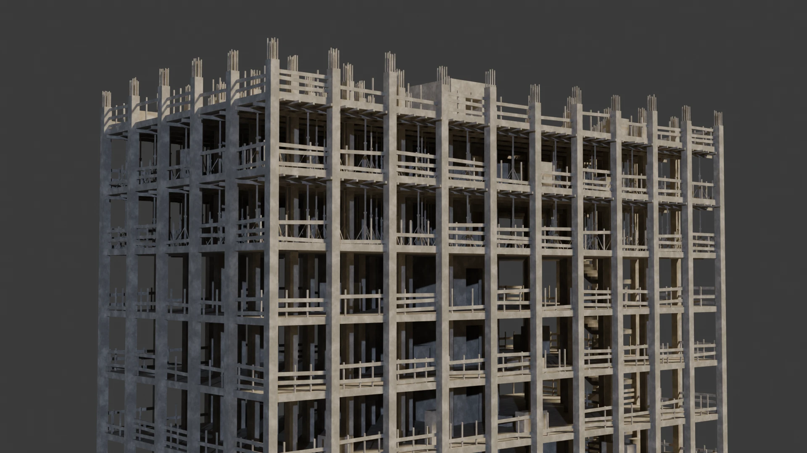
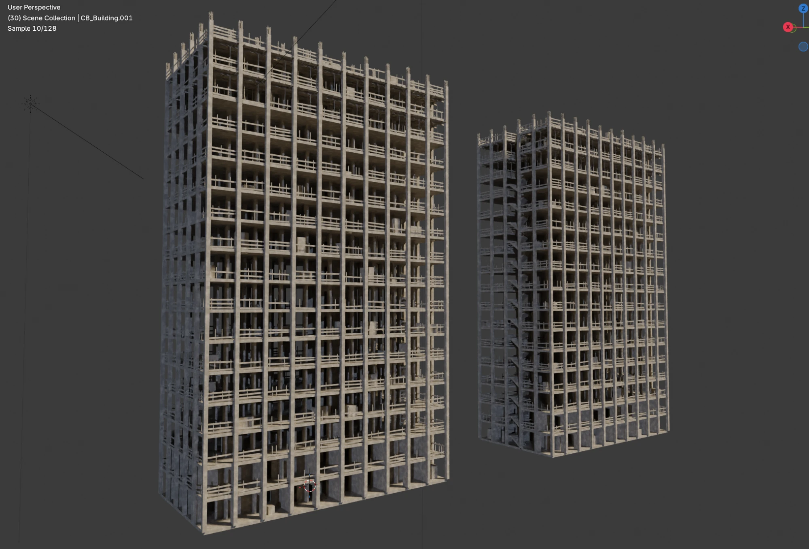
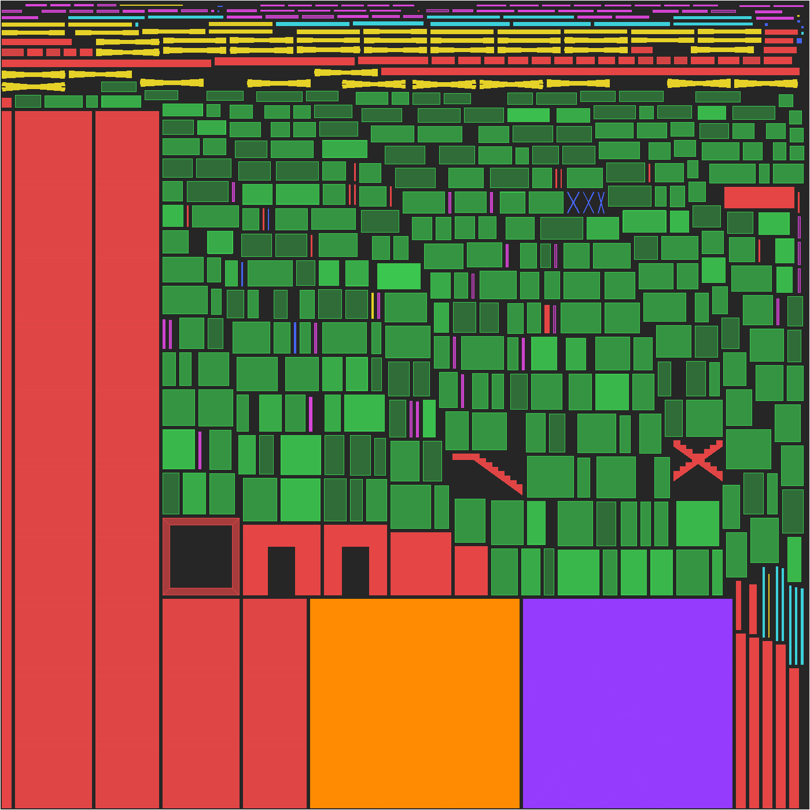

# ConstructionBuilder

[English](README.md) | **Русский**





Расширение для Blender 5.2+, которое строит каркас строящегося здания: плиты перекрытий, колонны с арматурой, внутренние стены, лифтовые шахты, пожарные лестницы, стойки опалубки, ограждения, строительные лампы и мусор, как у монолитного железобетонного дома на стадии «коробки». Результат сразу готов для игрового движка: у каждого объекта есть UV (Box Projection, упаковка в один тайл 0–1), экспорт в FBX одной кнопкой.

Здание может быть прямоугольным, Г-образным, П-образным или со стилобатом (высоким первым этажом).

## Установка

1. Соберите zip (один раз, из любой папки):

   ```bash
   "C:\Program Files\Blender Foundation\Blender 5.2\blender.exe" -b --command extension build --source-dir D:\Blender\ConstructionBuilder --output-dir D:\Blender\ConstructionBuilder\dist
   ```

   Папка `dist` должна существовать, создайте её заранее.

2. В Blender: **Edit → Preferences → Get Extensions → стрелка в правом верхнем углу → Install from Disk** и выберите `construction_builder-0.19.0.zip`.
3. Включите расширение **ConstructionBuilder**.

Для разработки можно не собирать zip: в **Preferences → Get Extensions → Repositories → Add Local Repository** укажите папку, где лежит `ConstructionBuilder`, или просто скопируйте папку расширения в `%APPDATA%\Blender Foundation\Blender\5.2\extensions\user_default\`.

## Версии

Версия хранится в одном месте: поле `version` в `blender_manifest.toml`. Она показывается вверху панели и входит в имя zip (`construction_builder-0.19.0.zip`). Любое изменение кода поднимает версию, запись добавляется в [CHANGELOG.md](CHANGELOG.md). Чтобы обновить установленное расширение, удалите старое и установите новый zip.

## Где панель

3D Viewport → боковая панель **N** → вкладка **ConstructionBuilder**.

## Язык

Панель по умолчанию на английском. Переключите Blender на русский (**Edit → Preferences → Interface → Language → Русский**, с галками Interface и Tooltips), и панель, подсказки, кнопки и сообщения будут на русском. Документация на английском ([README.md](README.md)) и на русском ([README.ru.md](README.ru.md), этот файл); комментарии в коде на двух языках.

## Как работать

1. Задайте параметры здания (таблица ниже).
2. Нажмите **Rebuild**. Здание появится в коллекции `ConstructionBuilder`.
3. Изменили параметры? Снова **Rebuild**: старый результат заменяется новым.
4. **Export FBX** сохраняет всё в один файл (и ID-маску PNG рядом), **Open Folder** открывает папку с ним.

Параметры не применяются сами: пока вы не нажали Rebuild, в сцене остаётся предыдущая версия.

## Параметры

Парные поля (например, Width/Depth) стоят в панели в одной строке.

| Параметр | Что делает | По умолчанию |
|---|---|---|
| Modules X / Y | Число модулей пола по X (ширина здания) и по Y (длина) | 4 / 3 |
| Floors | Число этажей (плит) | 5 |
| Shape | Форма здания сверху: Rectangle, L-shape (Г) или U-shape (П) | Rectangle |
| Cut Width / Depth | Размер вырезаемого блока в модулях (только для L и U) | 2 / 2 |
| Floor Height | Расстояние между соседними плитами, м | 3 |
| Module Size | Сторона квадратного модуля и шаг сетки колонн, м | 3 |
| Podium | Стилобат: первый этаж в несколько раз выше, с шахтой и лестницей, но без перегородок. Стены, мусор и ограждения начинаются со 2-го этажа | выкл. |
| Podium Height | Во сколько обычных этажей высотой первый этаж (только со стилобатом) | 2 |
| Edge Bias | Случайные детали (лампы, отверстия, мусор) собираются у наружного края здания. В самом глубоком модуле шанс на столько ниже, чем у края: 0 = ровно, 1 = в середине ничего | 0.7 |
| Center on Origin | Центрировать здание в нуле (иначе его угол стоит в нуле) | выкл. |
| Slab Thickness | Толщина плиты, м | 0.3 |
| Ground Slab | Плита на уровне земли, чтобы здание стояло на земле. Верх на Z = 0, есть толщина по краю, нижней грани нет (она в земле) | вкл. |
| Column Size (Width/Depth) | Размер колонны по X / по Y, м | 0.4 / 0.4 |
| Column Top Extension | На сколько колонны торчат выше верхней плиты, м (как выпуски арматуры на стройке) | 1 |
| Height Variation | Каждая колонна поднимается над верхней плитой ещё на случайную высоту от 0 до этого значения, м, чтобы верхушки были разными | 0.5 |
| Seed | Зерно случайности: при том же значении Rebuild даёт ту же высоту колонн, прутьев, те же стены, двери, ограждения, мусор, лампы и отверстия | 1 |
| Rebar | Добавить арматуру: 9 прутьев на верхушке каждой колонны | вкл. |
| Rebar Height | Насколько прутья торчат над колонной, м | 0.8 |
| Height Random | У каждого прута своя высота: Rebar Height ± это значение, м (случайно, зависит от Seed) | 0.1 |
| Rebar Size | Сторона квадратного сечения прута, м | 0.04 |
| Walls | Построить внутренние стены (наружный контур остаётся открытым каркасом) | вкл. |
| Wall Floors | Этажи со стенами: `1-3, 5` или `all`. Этаж 1 лежит между землёй и первой плитой | 1-2 |
| Wall Thickness | Толщина стены по линии сетки, м | 0.2 |
| Wall Chance | Доля внутренних рёбер сетки, на которых строится стена (случайно, зависит от Seed). Одинакова на всех этажах, комнаты стоят друг над другом. 1 = стены везде | 1 |
| Door Chance | Доля стен с дверным проёмом (случайно, зависит от Seed), остальные глухие | 0.4 |
| Door (Width/Height) | Ширина и высота проёма, м. Проём по центру стены, от пола | 1.2 / 2.1 |
| Elevator Shafts | Построить лифтовые шахты | вкл. |
| Count | Сколько лифтовых шахт. Стоят в ряд вдоль X в среднем ряду здания, по центру | 1 |
| Padding | Свободный промежуток между соседними шахтами, м (округляется до целых модулей): 3, 9, 18 | 9 |
| Custom Modules | Необязательно. Модули шахт вручную парами X,Y от 1 через `;`: `2,2; 8,2`. Если поле заполнено, Count и Padding не действуют | пусто |
| Shaft Wall | Толщина стены шахты, м | 0.3 |
| Top Block | Высота верхнего блока шахты над крышей, м: её последний этаж с дверью, он стоит на верхней плите. Дверь есть, если блок не ниже 1.5 м. 0 = шахта кончается на крыше | 3 |
| Door Side | Сторона шахты с дверью на каждом этаже: -Y, +Y, -X, +X | -Y |
| Corner Columns | Что делать с четырьмя угловыми колоннами шахты, которые иначе оказались бы внутри стен её верхнего блока: Trimmed (кончаются на полу крыши, без арматуры), Removed (убрать, шахта сама несёт перекрытия), Full (как все остальные) | Trimmed |
| Clear Walls | Внутренних стен нет в радиусе этого числа модулей вокруг шахты, чтобы шахта была видна. 0 = только модуль самой шахты | 1 |
| Fire Stairs | Пожарные лестницы: дыра в каждой плите с лестницей внутри | вкл. |
| Style | Вид маршей: Concrete Flight (цельный бетонный марш: ступени на наклонной плите, как сборный марш) или Blocks (по одному боксу на ступень лесенкой) | Concrete Flight |
| Position | Где стоят лестницы: Center (одна по центру), Edge (одна с края, у -X), Both Ends (по одной на каждом торце вдоль X) | Center |
| Built Up To Floor | Лестница построена от земли до этого этажа. Выше остаётся только дыра в полу. 0 = только дыры | 3 |
| Formwork Props | Стойки опалубки под верхними плитами | вкл. |
| Top Slabs (Formwork) | Под сколькими верхними плитами стоят стойки | 2 |
| Spacing | Шаг стоек, м (округляется так, чтобы в модуль влезло целое число) | 1.5 |
| Overhang | На наружном краю здания деревянные балки торчат за плиту на случайную длину от четверти этого значения до него, м. 0 = балки кончаются вровень с плитой | 0.4 |
| Tripods | Тренога из трёх раскосов на полу у каждой стойки. Выключите, чтобы было меньше полигонов | вкл. |
| Railings | Ограждения по открытым краям плит | вкл. |
| Floors (Railings) | Этажи с ограждениями: `3-6` или `all`. Нумерация как у `Wall Floors`: 1 это земля, последний номер это крыша | all |
| Height (Railings) | Высота ограждения над плитой, м | 1.1 |
| Boards (Min/Max) | Сколько горизонтальных досок в каждом пролёте ограждения: случайно от и до | 1 / 3 |
| Posts (Min/Max) | Сколько вертикальных стоек в каждом пролёте: случайно от и до | 1 / 3 |
| Tilt | У каждой доски случайный наклон от минус этого значения до плюс него | 5° |
| Lamps | Строительные лампы под плитами | вкл. |
| Floors (Lamps) | Этажи с лампами: `2-5` или `all`. Лампы этажа k висят под плитой k | all |
| Factor (Lamps) | Доля модулей, где висит лампа, до учёта Edge Bias | 0.3 |
| Length (Min/Max) (Lamps) | Длина лампы, м | 0.8 / 1.6 |
| Slab Holes | Случайные квадратные отверстия в плитах (для труб), больше у края | вкл. |
| Factor (Holes) | Доля модулей плиты с отверстием, до учёта Edge Bias | 0.08 |
| Size (Min/Max) (Holes) | Сторона квадратного отверстия, м | 0.5 / 1 |
| Debris | Добавить мусор: боксы (кирпичи, поддоны) на полах | вкл. |
| Floors (Debris) | Этажи с мусором: `1-3, 5` или `all`. Нумерация как у `Wall Floors`: 1 это земля, последний номер (этажей + 1) это крыша | all |
| Factor (Debris) | Доля модулей на выбранных этажах, где стоит бокс (случайно, зависит от Seed). 0 = нет, 1 = в каждом | 0.2 |
| Height / Length / Width (Min/Max) | Диапазоны размеров бокса, м | 0.5-2 / 1-2 / 0.4-1 |
| One Material | При экспорте у всех объектов один материал `CB_Building` с ID-маской, чтобы в FBX и Substance был один texture set. Цветные материалы групп после экспорта возвращаются | вкл. |
| Single Mesh | Запечь всё здание в один меш `CB_Building` с одним материалом и одной UV, чтобы удобнее текстурить | выкл. |
| UV Margin | Зазор между островками UV в тайле (сам уменьшается, если островков очень много) | 0.005 |
| Split Slabs | Резать UV плит на куски (см. Cut Size) вместо одного огромного островка на этаж. Одинаковые куски ложатся друг на друга, поэтому плиты занимают мало места, а остальное здание получает более крупный масштаб. Текстура плиты тогда повторяется в каждом куске | вкл. |
| Cut Size | Размер куска плиты в модулях: 3 = 3 x 3 модуля (9 x 9 м при модуле 3 м). Мелкие куски экономят больше места, но текстура повторяется чаще | 3 |
| Cut Height | Резать UV высоких объектов (колонн на много этажей) через каждые столько метров: очень высокий островок ограничил бы масштаб всего тайла. Здание ниже этой высоты (меньше 10 этажей по 3 м) не режется. 0 = не резать | 30 |
| Group by Material | Делить UV-островки на группы (бетон, полы, потолки, мусор, опалубка, ограждения, балки, лампы): друг на друга ложатся только островки одной группы, и у каждой группы свой цвет в ID-маске | вкл. |
| ID Mask | Цветная ID-маска (PNG) и плоский материал цвета группы на каждом объекте | вкл. |
| Mask Size | Размер ID-маски, пиксели | 2048 |
| Overlap Similar | Класть островки похожего размера друг на друга, чтобы экономить место | вкл. |
| Similarity | Насколько близки должны быть размеры островков: ширина и высота различаются не больше чем на эту долю (0.02 = 2%, как Range в TechArt Tools) | 0.02 |

Под параметрами здания панель показывает итоговый размер: ширина × длина × высота в метрах и число модулей. Высота = Floors × Floor Height (плюс добавка стилобата).

## Что строится

### Объекты

Десять мешей в коллекции `ConstructionBuilder`, все с началом координат в (0, 0, 0):

* **`CB_Floors`**: все плиты всех этажей.
* **`CB_Columns`**: все колонны с арматурой.
* **`CB_Walls`**: внутренние стены. Объект создаётся, только если стены включены и на выбранных этажах есть что строить.
* **`CB_Shafts`**: лифтовые шахты. Объект создаётся, только если шахты включены и модули заданы верно.
* **`CB_Stairs`**: пожарные лестницы. Объект создаётся, только если лестницы включены и `Built Up To Floor` больше 0.
* **`CB_Formwork`**: стальные стойки опалубки (опорные плиты, трубы, муфты, верхние плиты, треноги). Объект создаётся, только если опалубка включена.
* **`CB_FormworkBeams`**: деревянные балки опалубки (оба слоя). Отдельный объект, чтобы у дерева был свой ID.
* **`CB_Railings`**: ограждения. Объект создаётся, только если они включены и есть открытые края.
* **`CB_Lamps`**: строительные лампы под плитами. Объект создаётся, только если лампы включены и хотя бы одна выпала.
* **`CB_Debris`**: строительный мусор. Объект создаётся, только если мусор включён и хотя бы один бокс выпал.

С `Single Mesh` вместо них один объект `CB_Building`.

Не переименовывайте их: по этим именам Rebuild находит и обновляет старый результат. Всё, что вы поправили руками в этих мешах, при Rebuild пропадёт.

### Плиты

* Плита состоит из квадратных модулей (по умолчанию 3×3 м).
* **Плита на земле** (`Ground Slab`, включена по умолчанию): такая же плита, как остальные, с верхом на Z = 0 и толщиной вниз. Её низ в земле, поэтому **нижней грани нет**, а верх и торцы по контуру остаются (видна толщина). Плита сплошная: под шахтой и лестницей дыры нет, они стоят на ней. Всё, что построено выше (стены, лестницы, мусор на этаже 1), остаётся на тех же высотах. Колонны начинаются на Z = 0.
* Первая плита этажа стоит на высоте одного этажа. Если `Ground Slab` выключена, на уровне земли плиты нет и колонны стоят от нуля.
* Верх последней плиты лежит на высоте `Floors × Floor Height` (плюс добавка стилобата).
* **Модули сшиты в один меш.** У каждого модуля есть верх и низ, а боковые грани есть только там, где соседа нет:
  * угловой модуль: 2 боковые грани;
  * модуль на краю: 1 боковая грань;
  * внутренний модуль: боковых граней нет.

  Затем совпадающие вершины сливаются. Внутри плиты нет лишних полигонов и швов, наружу смотрит только торец.
* В верхних плитах прорезаны случайные квадратные отверстия (см. «Отверстия в плитах») и проёмы под шахты и лестницы.

### Колонны

* Колонна стоит в каждом узле сетки модулей, то есть в каждом углу каждого модуля.
* Колонна идёт от земли до верха последней плиты плюс `Column Top Extension`.
* Колонны просто **пересекают** плиты насквозь: булевых операций нет, меши не склеиваются.
* У колонны нет нижней грани: низ уходит в землю.
* Над верхней плитой колонны разной высоты: `Column Top Extension` плюс случайная добавка от 0 до `Height Variation` (зависит от `Seed`).
* **Арматура.** Из верха каждой колонны торчат 9 тонких боксов, сетка 3×3. Высота каждого прута своя: `Rebar Height` ± `Height Random`. Прут начинается чуть внутри колонны, нижней грани у него нет. Все грани прутьев имеют сглаживание (одна группа сглаживания), грани колонн остаются плоскими. Выключается галочкой `Rebar`. Прутья входят в меш `CB_Columns` и делят с ним UV.

### Стены

* Только **внутренние**: не больше одной стены на каждое внутреннее ребро сетки между двумя модулями. Какие рёбра получат стену, решает `Wall Chance`. Наружные стены не строятся, периметр остаётся открытым каркасом.
* Стена стоит между двумя колоннами и между двумя плитами: от верха нижней плиты (на первом этаже от земли) до низа верхней. В колонны и плиты стена не заходит.
* Толщина стены задана по линии сетки (центр стены на линии), колонна шире стены.
* Два вида стен:
  1. **Глухая**: прямоугольник.
  2. **С дверью**: проём от пола по центру стены, над ним перемычка.
* Вид выбирается случайно: доля стен с дверью задаётся `Door Chance`, результат зависит от `Seed` и повторяется при Rebuild. Каждый выбор привязан к самому элементу и `Seed`, поэтому смена списка этажей `Wall Floors`, `Clear Walls` или `Wall Chance` остальные стены и двери не перемешивает.
* Топология двери оптимизирована: каждая сторона стены из трёх четырёхугольников, границы которых идут от верхних углов стены к верхним углам проёма. На верхнем ребре нет лишних вершин.
* Построены только видимые поверхности: две стороны, а у двери ещё откосы и низ перемычки. Торцы (касаются колонн), верх и низ (касаются плит) не строятся.
* Стены входят в общую UV-карту и в FBX.

### Лифтовые шахты

* Шахта занимает один модуль. Число шахт задаёт `Count`, отступ между ними `Padding` в метрах (3, 9, 18: это 1, 3, 6 свободных модулей между шахтами). Шахты ставятся в ряд вдоль X в среднем ряду здания, симметрично по центру. Если шахты не помещаются, панель показывает предупреждение.
* Хотите другое место: заполните `Custom Modules` парами X,Y от 1, например `2,2; 8,2`. Тогда Count и Padding не действуют.
* Шахта это полая труба вокруг модуля: наружная и внутренняя стороны и верхнее кольцо. Нижней грани нет, шахта стоит в земле.
* **Дверь на каждом этаже и в верхнем блоке**: один проём (ширина и высота как у `Door Width / Height`) на стороне `Door Side`, по центру, от пола этажа. Проём сквозной: есть откосы и низ перемычки. Дверь есть на всех этажах, независимо от `Wall Floors`.
* Каждая сторона разбита по высоте на этажи и перекрытия на одних и тех же уровнях, поэтому на угловых рёбрах нет лишних T-вершин. Топология двери та же, что у стен.
* **Верхний блок.** Шахта кончается блоком над крышей, как машинное помещение (машинный блок) лифта: он стоит на верхней плите, высота задаётся `Top Block` (по умолчанию 3 м), и в нём есть дверь на той же стороне. Сверху блок закрыт кольцом. Блок ниже 1.5 м остаётся глухим, `0` убирает его.
* Стена шахты стоит по линии сетки, как у остальных стен.
* В плитах под шахтой **дыра**: модуль плиты на этом месте не строится, по краю дыры появляются боковые грани.
* **Вокруг шахты нет внутренних стен**: в радиусе `Clear Walls` модулей стены не строятся, чтобы шахту было видно (по умолчанию 1 модуль).
* **Угловые колонны шахты.** У шахты четыре угловые колонны. Верхний блок шахты выше колонн, поэтому колонны оказывались внутри его стен, а арматура торчала из стены. `Corner Columns` решает это: `Trimmed` (по умолчанию) обрезает такие колонны на уровне пола крыши и убирает арматуру, `Removed` убирает их совсем (углы шахты и так несут перекрытия), `Full` оставляет как было. Остальные колонны от этого не меняются.
* Две шахты в соседних модулях дают двойную стену между ними. Padding от 3 м убирает это.
* Шахты входят в общую UV-карту и в FBX.

### Форма здания

Здание задаётся набором модулей: из прямоугольника `Modules X` × `Modules Y` вырезается блок, вид сверху, +Y вверх.

* **Rectangle**: прямоугольник.
* **L-shape (Г)**: блок вырезан из правого нижнего угла, остаются верхняя перемычка и левая нога.
* **U-shape (П)**: блок вырезан из середины нижней стороны, остаются верхняя перемычка и две ноги.

`Cut Width` и `Cut Depth` задают размер блока в модулях. Они ограничиваются сами: всегда остаются перемычка (минимум один ряд) и нога (для П две). Плиты, колонны, стены, шахты, лестницы, мусор и UV подстраиваются под форму. Если в нужном месте у здания нет модуля, шахта или лестница сдвигаются на ближайший свободный.

### Пожарные лестницы

* Лестница занимает один модуль целиком, от кромки до кромки. В плитах на этом месте **дыра на каждом этаже**.
* `Built Up To Floor` задаёт этаж, до которого лестница построена. Выше этого этажа остаётся только дыра в полу, лестницы там ещё нет: как на настоящей стройке.
* Каждый этаж: два марша и **площадка между ними** на половине высоты. Первый марш идёт вдоль левой стороны модуля до площадки, второй возвращается вдоль правой и выходит на уровень следующего этажа. Между маршами остаётся узкий зазор.
* Площадка занимает всю ширину модуля и упирается в угловые колонны (пересекает их, как остальные элементы каркаса), поэтому щелей между лестницей и каркасом нет.
* Ступени высотой около 0.19 м (8 ступеней на марш при этаже 3 м) в обоих стилях.
* `Style`:
  * **Concrete Flight**: цельный бетонный марш. Ступени сверху, под ними наклонная плита толщиной 0.25 м. Низ площадки и низ марша лежат в одной плоскости, как на сборном марше. У марша нет торцевых граней: они упираются в площадку или плиту.
  * **Blocks**: по одному боксу на ступень, боксы идут диагональной лесенкой и касаются друг друга углами.
* Лестница начинается с той стороны модуля, где есть соседний модуль здания (обычно -Y), чтобы выходить на плиту.
* `Position`: `Center` одна по центру, `Edge` одна с края (у -X), `Both Ends` по одной на каждом торце. Лестница стоит в среднем ряду, не занимает модуль шахты. Если в нужном месте у здания нет модуля (формы Г и П), берётся ближайший свободный, у которого есть сосед сверху или снизу, чтобы лестница выходила на плиту, а не в пустоту.
* Рядом с лестницей нет внутренних стен и мусора.
* Лестницы входят в общую UV-карту и в FBX.

### Стойки опалубки

Телескопические стальные стойки под свежезалитыми плитами: сразу видно, что здание строится. Сделаны по фото настоящей опалубки.

* Стойки стоят на **верхних этажах**, под `Top Slabs` верхними плитами (по умолчанию под двумя). Одна плита даёт стойки только на самом верхнем этаже.
* В каждом модуле сетка стоек с шагом около `Spacing` (при 3 м и шаге 1.5 м это 4 стойки на модуль). Сетка по центру модуля, подальше от краёв, поэтому стойки не пересекают колонны и стены.
* Стойка: опорная плита внизу, **толстая нижняя труба, муфта и более тонкая верхняя труба**, верхняя плита. С включённой `Tripods` у каждой стойки внизу **тренога из трёх раскосов**. Всё простые боксы, раскосы это тонкие наклонные бруски.
* Сверху два слоя деревянных балок, как на фото: несущая балка по ряду стоек вдоль X лежит на верхних плитах стоек, а на ней поперёк лежат более тонкие балки (около каждых 0.75 м) прямо под плитой.
* **Балки торчат за край.** На наружном краю здания каждая балка выступает за плиту на свою случайную длину (от четверти `Overhang` до него), поэтому длины чуть разные, как в жизни. Выступы есть у верхних балок поперёк и у несущих балок по ряду стоек. В проёмах шахты и лестницы балки обрываются на кромке.
* В модулях под шахтой и лестницей стоек нет, над отверстием в плите они тоже не стоят.
* Сталь это `CB_Formwork`, дерево `CB_FormworkBeams`. Оба входят в общую UV-карту и в FBX.
* Много граней: около 13 тысяч на здании 9×4 модуля с двумя плитами при шаге 1.5 м и около 10 тысяч без треног. Шаг 1 м удваивает это число.

### Ограждения

Защитные ограждения по открытым краям плит, как их ставят на стройке. Каждый пролёт между угловыми колоннами разный, чтобы не выглядело одинаково.

* Они стоят по наружному краю здания и по краям лестничных проёмов. Шахту не огораживают: у неё стены.
* **Горизонтальные доски:** в каждом пролёте случайное число от `Boards Min` до `Boards Max` (по умолчанию от 1 до 3). Высота каждой доски случайная, промежутки между досками тоже. У каждой доски свой случайный наклон от −`Tilt` до +`Tilt` (по умолчанию ±5°). Концы досок чуть заходят в колонны.
* **Вертикальные стойки:** случайное число от `Posts Min` до `Posts Max` (по умолчанию от 1 до 3), расставлены по пролёту с разными промежутками. Доски лежат на наружной стороне стоек.
* Всё привязано к `Seed` и к самому пролёту: Rebuild повторяет результат, смена других настроек ограждения не перемешивает.
* Сторона проёма, куда выходит лестница, остаётся открытой на этажах до `Built Up To Floor`. Выше этого этажа, где лестницы ещё нет, проём огорожен со всех сторон.
* `Floors` задаёт этажи (нумерация как у стен: 1 это земля, последний номер это крыша, ограждения на земле нет). `Height` задаёт высоту ограждения над плитой.
* Объект `CB_Railings` входит в общую UV-карту и в FBX.

### Стилобат (Podium)

Вариант здания со стилобатом: первый этаж выше остальных, как нижняя часть с магазинами или входной группой.

* Галка `Podium` и `Podium Height`: первый этаж в 2 (или 3, 4...) раза выше обычного. Всё, что выше, поднимается на разницу.
* На стилобате **есть** лифтовая шахта и лестница, но **нет перегородок**.
* Стены, мусор и ограждения берутся **со 2-го этажа**. Если в `Wall Floors` указан этаж 1, на нём всё равно стен не будет. Ограждения первыми стоят на крыше стилобата.
* Лестница на высоком этаже строится как несколько обычных ярусов друг над другом, поэтому шаг ступеней остаётся нормальным. Лифт по-прежнему с дверью на каждом этаже, на высоком этаже одна дверь.
* Стойки опалубки под плитой стилобата получаются высокими (до этажа в 2 раза выше).
* Без стилобата здание остаётся ровно таким же, как раньше (проверено побитовым сравнением на 5 конфигурациях).

### Ближе к краю (Edge Bias)

Центр здания и так виден, поэтому там деталей должно быть меньше. У каждого модуля есть вес от 1 (внешнее кольцо и края вырезов формы Г и П) до `1 − Edge Bias` (самый глубокий модуль). Шанс лампы, отверстия и бокса мусора умножается на этот вес. `Edge Bias` = 0 даёт равномерно, 1 убирает детали из середины совсем.

### Лампы (Lamps)

Небольшие длинные прямоугольники под плитами, строительные лампы.

* На каждый модуль на выбранных этажах (`Floors`: потолок этажа k это плита k) приходится не больше одной лампы с вероятностью `Factor` × вес модуля. Лампы собираются **по периметру**.
* В наружном модуле лампа лежит **параллельно наружному краю** на расстоянии 0.35–0.8 м от него, чтобы быть видной снаружи. В середине здания лампа может лежать где угодно и бывает редко.
* Размер 0.1 × 0.06 м, длина случайная от `Length Min` до `Length Max`. У лампы нет верхней грани (она у потолка).
* Под верхними плитами, где стоит опалубка, ламп нет. Под отверстием в плите лампа не висит.
* Всё привязано к `Seed` и к самому модулю.
* Лампы это своя группа (`CB_Lamps`, пурпурный цвет в ID-маске, материал `CB_Lamps`).

### Отверстия в плитах (Slab Holes)

Случайные квадратные отверстия для труб и тому подобного.

* В плитах 1..N у некоторых модулей есть одно квадратное отверстие со стороной от `Size Min` до `Size Max`. Шанс `Factor` × вес модуля, поэтому отверстия **чаще у края**. В наружном модуле отверстие сидит близко к наружному краю, в середине где угодно.
* Отверстие держится не ближе 0.35 м к краю модуля, поэтому не задевает колонны и ограждения.
* Модуль с отверстием это плита с проёмом: верх и низ кольцами из четырёх четырёхугольников и четыре стенки проёма. Соседние модули по-прежнему сшиты в один меш.
* Мусор не стоит над отверстием, стойки опалубки не стоят над ним, лампы под ним не висят.
* В плите на земле отверстий нет.

### Мусор (Debris)

Боксы разной высоты и длины на полах, чтобы каркас выглядел живым и «на просвет» было интереснее: кирпичи, поддоны, ящики.

* На каждый модуль пола на выбранных этажах (`Floors`) приходится не больше одного бокса, он появляется с вероятностью `Factor` × вес модуля (в середине меньше).
* Этажи нумеруются как у стен: 1 это земля, 2 это пол над первым этажом, последний номер (этажей + 1) это крыша.
* Размер случайный в диапазонах: высота 0.5–2 м, длина 1–2 м, ширина 0.4–1 м. Бокс может лежать вдоль X или вдоль Y. Перепутанный порядок Min и Max не страшен.
* Бокс стоит внутри своего модуля с отступом от краёв, поэтому не пересекает колонны и стены. В модулях под шахтой и над отверстием боксов нет. Один бокс на модуль, так что боксы не пересекаются друг с другом.
* **Нижней грани нет**, остальные пять граней плоские (нижняя спрятана в плите или в земле).
* Всё привязано к `Seed` и к самому модулю: Rebuild повторяет результат, смена других настроек мусор не перемешивает.
* Объект входит в общую UV-карту и в FBX.

### UV, группы и ID-маска

Всё здание делит **одну UV-карту** (одна текстура на всё, тайл 0–1).



1. **Box Projection в метрах мира**: 1 м = 1 UV-единица, поэтому плотность текселей одинакова везде. Каждая грань проецируется по главной оси нормали, «верх» остаётся верхом, текстура не зеркалится.
2. **Группы.** С `Group by Material` каждый UV-островок принадлежит группе. Островки разных групп друг на друга не ложатся, поэтому у каждого места тайла в ID-маске ровно один цвет:

   | Группа | Что входит | Цвет ID | Материал |
   |---|---|---|---|
   | 1. Concrete | колонны, стены, шахты, лестницы, торцы плит | красный | `CB_Concrete` |
   | 2. Debris | мусор | зелёный | `CB_Debris` |
   | 3. Formwork | стальные стойки опалубки | синий | `CB_Formwork` |
   | 4. Railings | ограждения | жёлтый | `CB_Railings` |
   | 5. Beams | деревянные балки опалубки | голубой | `CB_Beams` |
   | 6. Lamps | лампы | пурпурный | `CB_Lamps` |
   | 7. Floors | верх плит | оранжевый | `CB_Floors` |
   | 8. Ceilings | низ плит | фиолетовый | `CB_Ceilings` |

   Плиты это один объект (`CB_Floors`), но группа выбирается **по грани**: верх = Floors, низ = Ceilings, торец = Concrete. Поэтому у пола и потолка может быть своя текстура (и свой ambient occlusion, без пятен от боксов, стоящих на плите). В Blender у `CB_Floors` три материала, выбираемые по грани. Группы, которой нет в здании, в маске нет.
3. **Резка плит.** Одна плита это огромный островок (36 м и больше), который съедает тайл. С `Split Slabs` UV плит режутся на куски по `Cut Size` модулей (3 = 9 x 9 м, по островку на кусок). Одинаковые куски тогда ложатся друг на друга и почти не занимают места, текстура плиты повторяется в каждом куске. Cut Size 1 экономит больше всего (куски 3 x 3 м), крупные куски повторяют текстуру реже.
4. **Стопки похожих.** Внутри группы островки похожего размера кладутся **друг на друга по центру**: пол на пол, дверь на дверь, стойка на стойку. Так делает To Stack в TechArt Tools: размеры сравниваются по ширине и высоте с допуском `Similarity` (по умолчанию 2%, как там), островок только сдвигается, без поворота и масштаба. Оверлап получается сильный, и это нормально. С выключенной `Overlap Similar` у каждого островка своё место, но масштаб тогда сильно мельче.
5. **Упаковка и масштаб.** Все стопки всех групп упаковываются вместе в **одну свободную раскладку**, без полосы на группу (полоса на группу оставляла много пустого места, масштаб был примерно на 40% мельче). Самые высокие стопки идут первыми, каждая следующая в самое низкое свободное место силуэта, а весь макет равномерно масштабируется так, чтобы поместиться в 0–1 (подбирается самый крупный подходящий масштаб). Это своя упаковка, а не оператор Pack Islands: оператор зависит от состояния редактора и в некоторых сессиях ничего не делал.

   Масштаб в долях тайла на метр (здание 9 x 5 x 6): полоса на группу и без резки 0.0136, одна свободная раскладка 0.0231, плюс резка плит по 9 м 0.0298 (это 61 пиксель на метр в текстуре 2048, было 28).

**ID-маска.** Картинка `CB_ID` (внутри Blender) и файл `<имя>_ID.png` рядом с FBX при экспорте: место каждой стопки залито цветом её группы, фон тёмно-серый. Как текстурить:

* В Substance Painter, Photoshop или Marmoset выбирайте материал по цвету маски: красное это бетон, зелёное мусор, синее стальные стойки опалубки, жёлтое ограждения, голубое деревянные балки опалубки, пурпурное лампы, оранжевое полы, фиолетовое потолки.
* В Blender материалы групп (`CB_Concrete` и остальные) плоского цвета ID, так что в режиме Material Preview группы сразу видно разными цветами. При экспорте по умолчанию один материал `CB_Building` (см. «Экспорт»).
* Маска проверена тестом: цвет под центром каждого полигона это цвет его группы (24 000 полигонов, без расхождений).

### Один меш (Single Mesh)

Галка `Single Mesh` (в блоке Export) склеивает все детали в **один меш `CB_Building`**: плиты, колонны, стены, шахты, лестницы, опалубку, ограждения, лампы и мусор. Так удобнее текстурить, например в Substance Painter: один объект и одна UV.

* UV остаётся прежней: общий тайл 0–1, группы, стопки похожих островков. Число вершин, граней, сглаживание и UV склеенного меша совпадают с суммой частей (проверено тестом).
* Материал один, `CB_Building` (один texture set). Он показывает ID-маску как базовый цвет, поэтому в Material Preview группы видны разными цветами. Материалы по группам (`CB_Concrete` и другие) в этом режиме не ставятся, иначе в Substance получилось бы несколько texture set на одной UV. Группу выбирайте по цвету из `<имя>_ID.png`.
* Склейка делается над данными меша, а не оператором Join: оператор зависит от состояния редактора.
* Rebuild каждый раз пересоздаёт `CB_Building`. Если выключить галку и нажать Rebuild, вернутся отдельные объекты, а `CB_Building` исчезнет.

### Экспорт

* Экспортируются все объекты одним файлом FBX (только меши). С `Single Mesh` это один объект `CB_Building`.
* **Один материал.** С галкой `One Material` (включена) на время экспорта у всех объектов ставится один материал `CB_Building` с ID-маской как базовым цветом. В FBX один материал и один texture set, группы различаются по `<имя>_ID.png`. Цветные материалы групп в Blender после экспорта возвращаются. Проверено повторным импортом FBX: один материал на всех объектах, без галки шесть.
* Файл по умолчанию: `ConstructionBuilder.fbx`. Имя меняется в поле **File**. Если включена `ID Mask`, рядом сохраняется `<имя>_ID.png`.
* Папка по умолчанию: `ConstructionBuilder` рядом с .blend-файлом. Если файл не сохранён, она создаётся в `Документах`. Другую папку можно выбрать в поле **Folder**.
* Если нажать **Export FBX** до первого Rebuild, будет сообщение «Press Rebuild first».

## Что дальше

Идеи для большей похожести на стройку: сетка на фасаде, строительный подъёмник, стопки арматуры, поддоны с кирпичом, горки песка.

## Структура

* `blender_manifest.toml`: описание расширения.
* `builder.py`: геометрия (форма, плиты, колонны, арматура, стены, шахты, лестницы, опалубка, ограждения, лампы, отверстия, мусор), упаковка UV, ID-маска, пересборка.
* `operators.py`: свойства, операторы (Rebuild, Export FBX, Open Folder) и панель.
* `translations.py`: русский перевод интерфейса.

## Ограничения

* Работает в Object Mode (при нажатии Rebuild из Edit Mode Blender сам переключится).
* Масштаб сцены 1 единица = 1 метр.
* Проверено на Blender 5.2.
